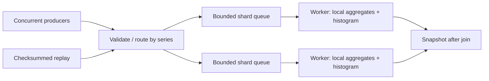

# Strata

A bounded, partitioned telemetry engine written in C++26. Strata routes numeric
events to worker-owned series aggregates, applies backpressure at a fixed memory
budget, drains or cancels explicitly, and replays a portable checksummed journal.
The library, load generator and benchmark use only the C++ standard library.

This is a focused systems component: useful for in-process service telemetry,
simulation measurements and replayable event analysis. It deliberately keeps the
concurrency and failure model small enough to audit. It is not a network service
or a durable database. Version 0.1 is tested engineering work, not a claim of
proven operation under every production workload.

## Features

- Preallocated bounded MPMC channel; the engine uses one consumer per shard.
- Per-key FIFO in queue admission order, batched dequeue and blocking or
  nonblocking admission with `std::stop_token` cancellation.
- Worker-owned count, extrema, Welford mean and sum of squared deviations.
- Drain, cancel, concurrent lifecycle calls and complete accepted-event accounting.
- Worker-local logarithmic latency histograms; no shared per-event atomic counter.
- Versioned little-endian frames, CRC32C, hostile-input allocation limits and
  explicit truncated-tail recovery.
- Constrained, value-owned event-stage pipelines with guarded C++26 pack indexing.
- Reproducible source generator, JSON diagnostics, burst loads, CPU work and SIGINT.
- Unit, integration, randomized contention, malformed-input and shutdown tests;
  separate ASan/UBSan and TSan configurations.
- Installable CMake package, strict warnings, optional LTO and CPU-specific builds.

## Architecture and decisions



`series % workers` assigns a key to exactly one worker. Each queue has its own
mutex and conditions. A mutex queue provides simple admission/close linearization
and stop-aware sleep; lock-free reclamation and unbounded spinning would add
complexity without a measured benefit here. Batching amortizes dequeue locking.
Work stealing is avoided because moving a key between workers would introduce
aggregate synchronization. A hot key therefore remains a single-shard bottleneck.

All queues, worker batches and series slots are allocated before workers start.
Shards are cache-line aligned; aggregates and histograms have a single writer.
Successful steady-state submission and aggregation allocate no storage. Error
strings, thread startup, snapshots and journal frames may allocate. PMR is not
needed for these fixed-lifetime buffers. The only explicit atomic in the engine
is a relaxed diagnostic counter for invalid events; queue ordering comes from
mutexes, and worker publication comes from `join`.

`close()` stops admission and drains. `cancel()` discards queued events and finishes
the batch already owned by each worker. Either operation joins workers, is
idempotent, and may run concurrently with producers or another lifecycle call.
Admission closes one shard at a time, rather than at a global instantaneous cutoff.
The caller must join its own producers before destroying the engine. Destruction
concurrent with any API call is invalid. Snapshots require completed shutdown;
live aggregate reads are intentionally excluded. After producer quiescence:

```text
accepted = processed + discarded
```

Configuration, admission, parsing and I/O failures use `std::expected<T, error>`.
Allocation failures propagate as exceptions. Worker startup system errors become
error values; partially started workers are closed and joined. Producer exceptions
are transported to the calling thread after all producers join. Worker processing
is `noexcept`. Destructors drain/close and cannot report stream flush errors;
call `journal_writer::flush()` explicitly.

See [architecture](docs/architecture.md) for synchronization and ownership details,
and [journal format](docs/journal-format.md) for recovery and binary layout.

## Layout

```text
include/strata/
  core/         configuration, event and error domain
  concurrency/  bounded channel
  runtime/      engine API and snapshots
  pipeline/     constrained event stages / pack indexing
  metrics/      mergeable latency histogram
  storage/      frame codec, journal writer and replay
  workload/     deterministic generator and validated options
src/            runtime, journal and workload implementation
tests/          independent executable suites + CLI integration
tools/          strata CLI
benchmarks/     paired repeated benchmark
examples/       minimal library client
cmake/          options and installable package configuration
.github/        GCC/Clang build and sanitizer CI
docs/           design, format and measured performance
```

## Toolchains and C++26

CMake 3.30+, Ninja (or another CMake generator), threads and a C++26-mode compiler
with a standard library implementing `std::expected` are required. There are no
downloaded C++ dependencies. Locally exercised Linux toolchains are GCC 15.2.0 and
Clang 21.1.8, both with libstdc++ 15 and CMake 4.2.3. CI uses Ubuntu 26.04 container
packages on Ubuntu 24.04 runners, with GCC 15 and Clang 21. Native MSVC is not a
validated target; Windows users can use WSL2 with these Linux toolchains.
Building the tests also requires Python 3.9+ (standard library only). Set
`BUILD_TESTING=OFF` for a library/tools build without Python.

`CXX_STANDARD 26`, `CXX_STANDARD_REQUIRED ON` and extensions disabled prevent silent
standard downgrade. CMake compile-checks `std::expected`. C++26 pack indexing
(`Stages...[I]`) selects a pipeline's stage type when
`__cpp_pack_indexing >= 202311L`; `std::tuple_element_t` supplies the equivalent
fallback. Default builds exercise pack indexing; `STRATA_FORCE_PACK_FALLBACK=ON`
exercises the fallback. The stage
accessor uses a deduced return type to avoid GCC 15's incomplete pack-index type
ABI mangling. No reflection, contracts or unavailable library features are assumed.
Concepts, requires expressions, variadic folds, `consteval` topology validation and
CRC table generation, spans, ranges, RAII, jthreads and expected are used where
they simplify the design. Most of these facilities predate C++26.

Compiler support remains partial: consult the official
[GCC](https://gcc.gnu.org/projects/cxx-status.html) and
[Clang](https://clang.llvm.org/cxx_status.html) support tables. The project makes no
claim of full C++26 language or library coverage.

## Build and run

```sh
git clone https://github.com/SpearyG/strata.git
cd strata

cmake -S . -B build/release -G Ninja \
  -DCMAKE_BUILD_TYPE=Release -DCMAKE_CXX_COMPILER=g++-15
cmake --build build/release -j
ctest --test-dir build/release --output-on-failure

./build/release/strata --events 1000000 --workers 4 --producers 4
./build/release/strata_example
```

The repository is private; cloning requires an authorized GitHub account.
`clang++-21` can replace `g++-15`. Build presets also work:

```sh
CXX=g++-15 cmake --preset debug
cmake --build --preset debug -j
ctest --preset debug

CXX=clang++-21 cmake --preset asan
cmake --build --preset asan -j
ASAN_OPTIONS=detect_leaks=1:halt_on_error=1 UBSAN_OPTIONS=halt_on_error=1 ctest --preset asan

CXX=clang++-21 cmake --preset tsan
cmake --build --preset tsan -j
TSAN_OPTIONS=halt_on_error=1 ctest --preset tsan
```

ASan and UBSan combine in one build; TSan must be separate. Use distinct build
directories when changing compilers. `RelWithDebInfo` is also supported. Optional
flags: `STRATA_ENABLE_LTO`, `STRATA_NATIVE` (nonportable generated instructions),
`STRATA_WARNINGS_AS_ERRORS`, `BUILD_TESTING`, `STRATA_BUILD_EXAMPLES`, and
`STRATA_BUILD_BENCHMARKS`. Sanitizer options target GCC/Clang on Linux.
Clang sanitizer builds need their compiler runtime package (for Ubuntu 26.04,
`libclang-rt-21-dev`); CI installs it explicitly.

To consume the installed library:

```sh
cmake --install build/release --prefix "$PWD/out/install"
```

Then use `find_package(strata CONFIG REQUIRED)` and link `strata::strata`; set
`CMAKE_PREFIX_PATH` to that installation prefix.

## Configuration and examples

`strata --help` and `strata_bench --help` list all switches. Invalid values, unknown
options, overflow and missing arguments produce a nonzero status. Counts are
bounded before allocations: workers/producers 1..256, series 1..1048576, combined
queue capacity at most 16777216 events, batch at most per-shard queue capacity.
Values must be finite and have magnitude at most 1e100, keeping Welford moments
within binary64 range for representable event counts. Series IDs are dense and
must be below the configured series count. Sequence and source timestamp are
opaque metadata, not deduplication or ordering controls.

```sh
# Bursts, bounded backpressure and observable source CPU work
./build/release/strata --events 200000 --workers 4 --producers 6 \
  --queue-capacity 1024 --batch-size 64 --burst 1000 --pause-us 500 --work 8 --seed 42

# Write a generated source journal before the separately timed concurrent run
./build/release/strata --events 100000 --journal measurements.strata
./build/release/strata --replay measurements.strata

# Disable per-event latency clock reads to measure their cost
./build/release/strata --events 1000000 --no-latency
```

`--journal` creates/truncates a file; it is a source recording, not a transactional
log of engine acceptance. Replay uses one feeding thread. `flush()` is a C++ stream
flush, not `fsync`; incomplete final frames are ignored and reported, complete
corruption fails. There is no multiwriter or append-existing protocol.
SIGINT requests cancellation; CLI status 130 and JSON accounting describe the
partial run. Burst sleeps are bounded to one second, so cancellation during a
sleep can be delayed by that pause.

JSON reports accepted/processed/rejected/discarded, throughput, queue high-water
bound, latency sample count, p50/p95/p99 upper bounds and observed maximum.
Latency measures **submission-attempt to aggregate completion**, including queue
admission wait. It excludes source generation time. Histograms use power-of-two
nanosecond buckets; quantiles are conservative bucket bounds, not exact samples.
Queue high-watermark is the sum of individual shard peaks, not a simultaneous
peak. `rejected` counts failed attempts, so a later retried event may be accepted.
The source fingerprint covers all four event fields. `aggregate_digest` consumes
all summary fields after timing, including under LTO; floating scheduling effects
can change this digest. Neither value is cryptographic.

Replay cancellation reports partial accepted/processed/discarded accounting and
`replay_complete`. `truncated_tail` is null if cancellation prevented inspecting
EOF; a complete replay has a boolean tail status. Other replay failures still
return an error. CLI and benchmark output failures return a nonzero status.

## Verification and performance

`ctest` runs unit checks, runtime integration, 32 seeded stress configurations,
codec roundtrips and hostile-input cases, workload reference aggregation, CLI
record/replay and benchmark smoke tests. Assertions remain active in Release.
Tests have finite work and CTest deadlines. Sanitizers supplement these checks;
they do not prove absence of every race or undefined behavior.

```sh
./build/release/strata_bench --events 1000000 --workers 4 --producers 4 \
  --queue-capacity 4096 --batch-size 64 --repeats 7 --warmups 1
```

The harness alternates batch-1 and batch-64 runs, performs warmups, validates counts
and a deterministic source fingerprint, and emits every sample plus median/range
as JSON Lines. It includes producer startup, generation, backpressure and draining;
engine allocation is excluded. `--work` simulates source work, not consumer work.
See [measured results and methodology](docs/performance.md) for actual measurements,
optimization evidence, latency and environment details.
The [production audit](docs/audit.md) records confirmed defects, invariants,
fault injection, remaining risks and validation. Its controlled comparison uses
one harness compiled against both engine revisions, with full reference checks
outside timing and raw samples retained under `docs/benchmarks/`.

## Limits and next steps

- In-process, fixed dense series space; no network protocol or distributed state.
- Single-consumer hot keys can dominate a shard; no work stealing or rebalancing.
- No live aggregate snapshots, rolling windows, user-defined engine processors,
  retention, delivery acknowledgements or exactly-once replay.
- No crash durability, file locking, disk quotas or authenticated framing.
- Mutex fairness depends on the OS scheduler; cancellation is cooperative.
- Floating moments can differ in final bits across producer schedules. Counts and
  numeric extrema are deterministic for an identical accepted set; cross-shard order is not.
- uint64 counters are finite; no overflow recovery for indefinitely running engines.
- Default topology is explicit rather than automatically tuned for a machine.

Future work should begin with workload-driven profiling: per-producer ingress
batching, configurable processors, finer latency buckets, windowed aggregation,
and bounded checkpoint/recovery. A network service or durable store would require
a separate protocol, security and persistence design.

MIT licensed. See [LICENSE](LICENSE).
