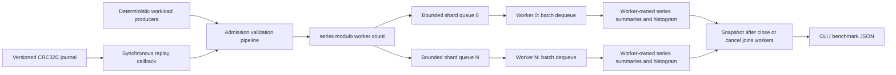

# Architecture and guarantees

Strata is an in-process telemetry aggregation engine. It accepts bounded-domain
numeric observations, partitions them by dense series ID, and computes count,
mean, sum of squared deviations, minimum, and maximum. The journal is a separate
source/replay component. It is not an acknowledgement log for the runtime.

## Subsystem relationships



The public headers follow these boundaries:

| Directory | Responsibility |
| --- | --- |
| `core/` | Event representation, finite-domain validation, configuration, error values |
| `pipeline/` | Constrained, short-circuiting admission stages and compile-time topology checks |
| `concurrency/` | Fixed-storage bounded channel, close/cancel semantics and queue accounting |
| `runtime/` | Worker ownership, sharding, admission, lifecycle and final snapshots |
| `metrics/` | Single-owner logarithmic latency histogram and post-join merge |
| `storage/` | Explicit wire encoding, CRC32C, journal writing and prefix recovery |
| `workload/` | Reproducible observations, producer orchestration, option parsing and JSON metrics |

## Admission and partition ownership

An event contains `sequence`, `series`, `value`, and `timestamp_ns`. Runtime
validation requires `series < series_count`, a finite value, and
`abs(value) <= 1e100`. The value bound keeps the squared deviations of realistic
stream lengths within binary64 range. `sequence` and `timestamp_ns` are preserved
metadata; neither deduplication nor event-time windows are implemented.

Routing is `series % workers`. The corresponding worker stores that series at
local index `series / workers`. Consequently each summary has exactly one
writer. Per-event aggregation uses Welford's online update, with no hash lookup,
virtual dispatch, cross-worker merge, or lock around summary updates. The
configured dense key domain trades arbitrary string keys and dynamic cardinality
for bounded memory and direct indexing.

Each successful enqueue has a linearization point under its channel mutex.
Events are FIFO within a shard in that insertion order. Simultaneous producers
have no sequence-number ordering guarantee, and workers have no cross-shard
ordering guarantee. Floating-point results can therefore differ slightly with
producer scheduling even when the source observations are identical.

## Why bounded mutex queues and batch dequeue

The reusable channel supports multiple producers and consumers; each runtime
shard uses multiple producers and one consumer. Its ring storage is allocated at
construction. One mutex protects ring indices, slots, lifecycle state, queue
counters, and peak depth. Consumers wait on a condition variable; blocking
producers use a stop-aware `condition_variable_any`.

A mutex queue gives the admission/close/discard rules a small synchronization
surface and avoids reclamation protocols, ABA problems, and producer reservation
holes. It is not lock-free and does not promise fairness or a hard latency bound.
Producers targeting the same shard still contend on that mutex.

The worker removes up to `batch_size` available events in one critical section;
it never waits for a full batch. It then processes them without holding the
queue lock. Removing a batch wakes all blocked producers because several slots
may have become available. Compared with a dequeue size of one, this amortizes
consumer locking and notifications while allowing short queues to be serviced
immediately. Producer admission remains per event. The benchmark compares these
two dequeue modes with the same source observations.

Work stealing was deliberately omitted. A worker stealing another shard's work
would require synchronizing series state or transferring ownership. A hot key
can saturate one shard while others are idle; more workers do not solve skew.

## Backpressure, shutdown and cancellation

| Operation | Admission | Work already accepted | Completion boundary |
| --- | --- | --- | --- |
| `submit(e, token)` | Waits for space, unless closed or cancellation is observed | One item is accepted under the queue mutex | Enqueued or an error value returned |
| `try_submit(e)` | Returns `full` immediately when the shard is full | No implicit dropping | Enqueued or an error value returned |
| `close()` | Closes every shard | Drains queued and in-flight work | All engine workers joined |
| `cancel()` | Cancels every shard | Discards queued items; completes batches already removed by workers | All engine workers joined |

Channel transitions are `open -> draining -> cancelled` or `open -> cancelled`.
Repeated close/cancel calls are safe. Closing a cancelled channel cannot reopen
it. Cancellation can escalate an ongoing drain because queue state changes
precede acquisition of the mutex that serializes worker joins. No join mutex is
held while a caller waits for a producer to release a queue lock.

Each shard changes admission state under its own mutex. There is no single
global shutdown timestamp across shards. Once close/cancel returns, all shard
admission is closed and workers are joined. A stop-token request is cooperative:
if a producer observes it before insertion, submission returns `cancelled`; a
request racing after that check may still allow the event to be accepted.

After all producer calls have returned and worker shutdown completes:

```text
accepted = processed + discarded
close without cancellation => discarded = 0
```

Rejected counts include invalid events, full nonblocking attempts, closed
submissions, and cancelled submissions. A caller retrying a full attempt adds a
rejection for the failed attempt and an acceptance if the retry succeeds.

`engine` owns its worker `jthread`s and drains in its destructor. It does not own
threads that call its API. Owners must finish/join producer threads before
destroying the engine; close/cancel wakes blocked submitters but cannot join
caller-owned threads. Concurrent destruction and another API call is invalid.
The workload runner keeps this ownership order explicit, including cleanup after
partial producer startup. Partial engine-worker startup is also closed and
joined before failure is returned.

## Memory layout and synchronization

Shards are separately allocated and aligned to 64 bytes to reduce sharing of
unrelated worker metadata. Queue communication necessarily shares state with
producers. Worker batches, queue rings, dense summaries, and histograms are
allocated before admission begins. Successful admission and worker processing
perform no explicit per-event heap allocation; error strings and snapshots may
allocate. No custom allocator or PMR layer is needed for this fixed-capacity
ownership model.

Ignoring container and synchronization overhead, storage scales as:

```text
workers * (queue_capacity + batch_size) * sizeof(queued_event)
+ series_count * sizeof(series_summary)
+ workers * sizeof(latency_histogram)
```

Configuration bounds worker count, series count, and total queue capacity before
allocation. A queue's accepted/rejected/discarded counters need no atomics because
the queue mutex already protects them. Invalid inputs never enter a queue; that
cold-path rejection counter uses a relaxed atomic because it publishes no event
data. Processed counts, summaries, and histograms are worker-local non-atomic
state. Worker join establishes the visibility required to read them.

`snapshot()` requires completed close/cancel and rejects an open engine. It
serializes against worker join and then copies final summaries and merges
histograms. This avoids locking the aggregation hot path or exposing a partially
updated Welford state. Rejected counts can still increase if callers submit
after shutdown; join all producers to obtain a final accounting snapshot.

## Type-level design

`event_stage` requires a `noexcept` callable returning `bool`. `pipeline` owns
stages by value and uses a fold expression to stop at the first rejection.
The runtime currently instantiates a validation stage; library users can compose
additional stages without a virtual interface. C++26 pack indexing selects a
stage type when `__cpp_pack_indexing >= 202311L`; a tuple-based implementation
provides the same interface when unavailable or explicitly forced. The accessor
deduces its return type to avoid exposing compiler-specific pack-indexed types
in function mangling. `valid_topology` performs compile-time deployment checks.

These facilities do not change the runtime configuration API into a large
template graph. Runtime values remain appropriate for worker and capacity
selection from a CLI.

## Metrics and measurement boundaries

Latency begins immediately before runtime admission validation and ends after
the worker updates the summary. It includes admission mutex contention, blocking
backpressure, queue residence, and aggregation. It excludes workload generation
before `submit`, journal I/O, and caller-side time between submissions.

Histograms use powers-of-two nanosecond buckets. Reported p50/p95/p99 are bucket
upper bounds capped at the observed maximum, not exact sample quantiles. The
maximum is exact at the clock's resolution. Disabling latency removes per-event
clock reads and histogram updates. Queue high watermark is the sum of shard
peaks, an upper bound on simultaneous queued work rather than a sampled global
peak.

Workload throughput divides processed events by elapsed time from producer
startup through final drain/join. Runtime construction and allocation are outside
that interval; source CPU work and optional burst pauses are inside it. Work is
performed by the source generator before submission, not by an extra engine
stage. The generator depends on sequence, seed, and options rather than thread
scheduling. The fingerprint observes source results and checks repeatability;
it is not a cryptographic integrity proof or a digest of aggregation state.

## Failure and persistence model

Expected operational failures use `std::expected<T, error>`. Error values contain
a category, a diagnostic message, and a byte offset where meaningful. Invalid
configuration and observations, backpressure rejection, cancellation, journal
I/O failures, malformed frames, and unsupported versions are explicit. Worker
startup system errors become an error value. Allocation failure and unexpected
exceptions propagate; the CLI reports them and the workload runner joins its
threads during cleanup. A stage cannot throw into the worker loop.

The journal writes versioned CRC32C frames with explicit little-endian fields and
bounded decoding. Replay is synchronous and feeds borrowed event spans to a
callback. A complete corrupt frame fails replay; an incomplete final frame is
ignored and reported. Earlier callbacks may already have produced effects before
a later error. Replay has no rollback or deduplication. See
[journal-format.md](journal-format.md) for the byte format and recovery boundary.

The writer creates/truncates a file and has a single owner. Its explicit flush
reports stream errors but does not issue `fsync` or guarantee crash durability.
Runtime acceptance does not mean an event has been journaled, and generated
journals are written separately from the concurrent timed workload. There is no
network transport, replication, distributed consensus, persistent aggregate
state, transactional replay, or restart checkpoint.
